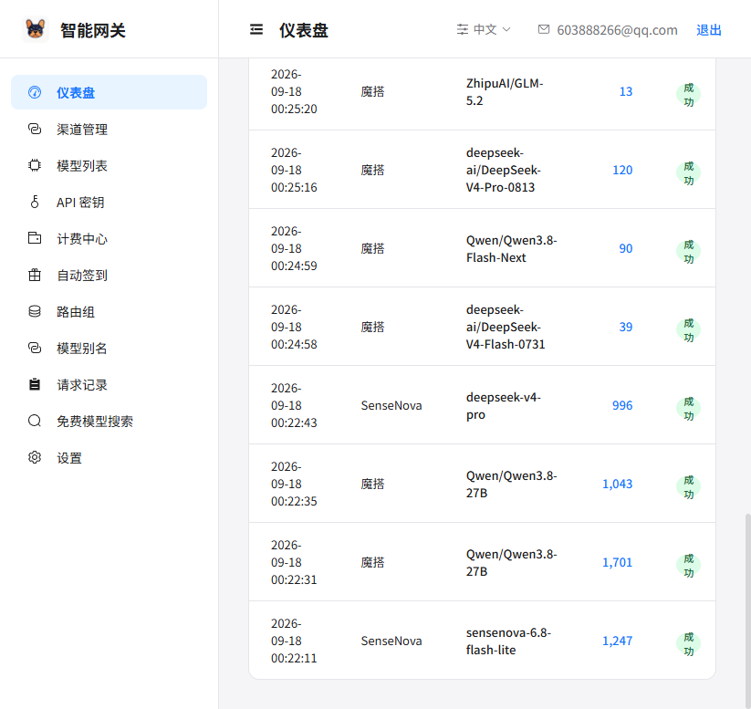
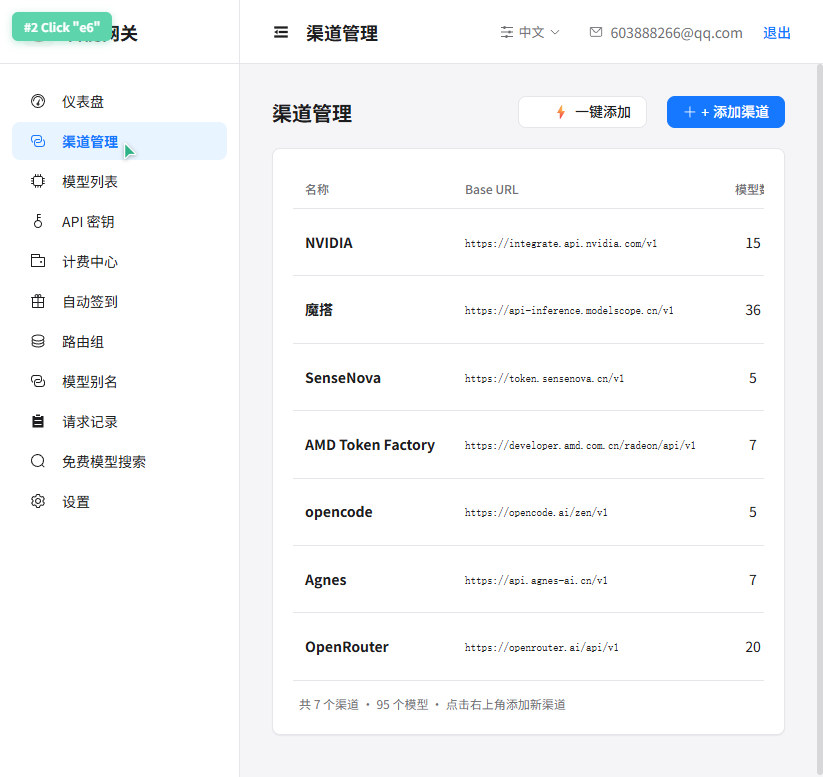
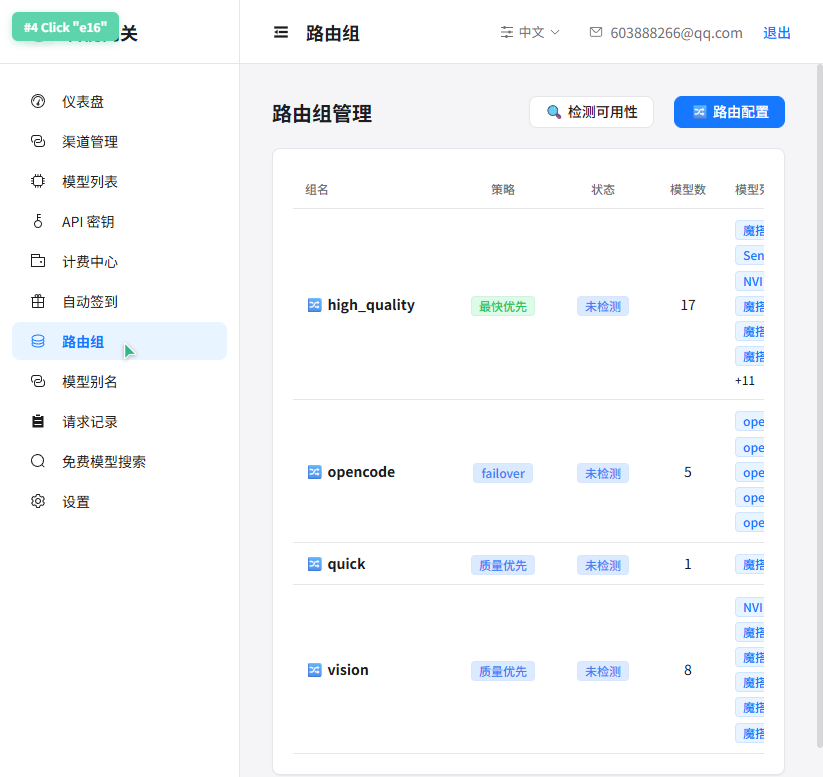
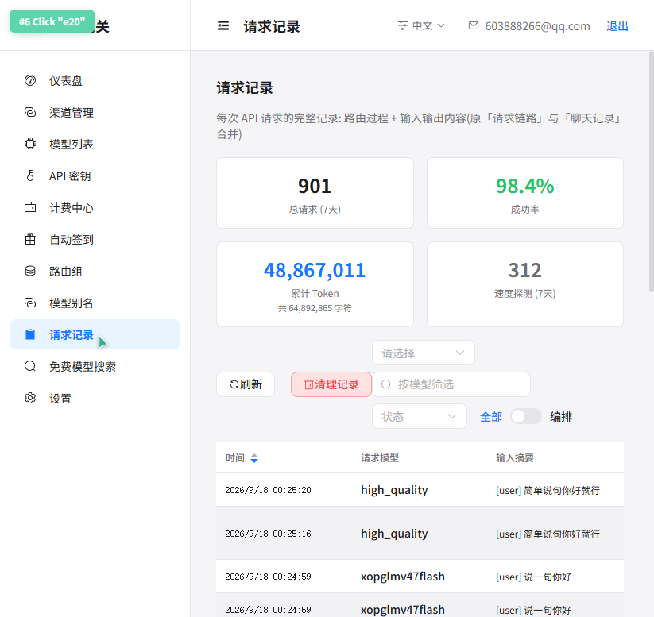
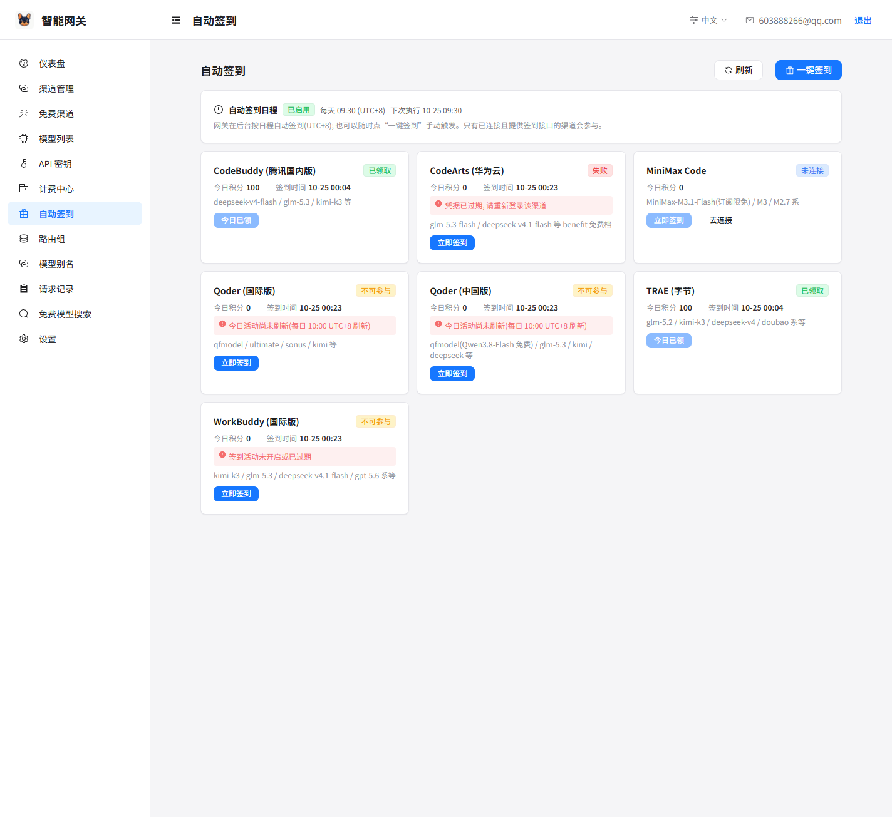

# ⚡ AI Gateway Pro · 智能网关

> **One OpenAI-compatible endpoint, aggregating free quotas from every model provider.**
> **一个兼容 OpenAI 的端点，聚合各家模型的免费额度。**
>
> Aggregate free quotas from NVIDIA / ModelScope / SenseNova / AMD / OpenRouter / OpenCode Zen and more, with intelligent routing, circuit breaking, failover, multi-model orchestration, streaming output, and full-stack tracing. Clients only pass a simple model name — routing decisions, failover, and quota control are all handled by the gateway.

> 🌐 **中文 README**: [README.md](README.md) · 📖 **Docs**: [docs/](docs/00-概览.md)

---

## ✨ Features

| Feature | Description |
|---------|-------------|
| **Multi-channel aggregation** | Consolidate NVIDIA, ModelScope, SenseNova, AMD, OpenRouter upstreams; AES-256-GCM encrypted keys; one-click templates & auto model fetching |
| **Smart routing** | `quick / high_quality / vision` groups + custom router groups; client uses `model: group_name` |
| **Routing strategies** | `quality` / `fastest` / `stable` priority strategies |
| **Weighted traffic spread** | Rotation + weighted random sampling (quality × daily-quota smoothing × channel cooldown) to spread free quotas evenly |
| **Circuit breaker + failover** | Auto-open on consecutive failures, half-open recovery; auto-switch to next candidate, seamless for streaming |
| **Rate-limit cooldown** | Exponential backoff on 429 (30s→60s→120s→300s) |
| **Multi-model orchestration** | `relay:gA/gB` (≤5 hops) and `review:main/reviewer`, streaming final output |
| **Streaming output** | OpenAI SSE streaming for single & orchestrated requests |
| **Model aliases** | Custom mapping (`gpt-4` → router group), compatible with existing OpenAI clients |
| **Auto vision** | Automatic channel selection for visual recognition, graceful text fallback |
| **Auto free-source sync** | Periodic merge of external free-source JSON with local templates |
| **OpenCode Zen auto-channel** | Auto-discover Zen free models, real probing + health keep-alive |
| **Free-model news search** | Daily crawl of free-model posts (Gitee/GitHub/Baidu/WeChat), feasibility evaluation & reports |
| **Request tracing** | Full log of routing reasons, actual channel/model, latency, breaker/limit hits, orchestration stages |
| **Usage stats + billing** | Request/token stats; free/pro/enterprise plans & order management |
| **Auto check-in** | Scheduled check-in for WorkBuddy / Trae to claim free quotas |
| **Multi-user + dual auth** | Per-user channels/routers/aliases/quotas; JWT + API Key |
| **i18n & design system** | zh-CN / EN switch; token-based unified visual design |
| **Desktop client** | pywebview + WebView2 shell, auto-start, embedded backend |

---

## 🖥️ Screenshots

| Screen | Preview |
|--------|---------|
| Dashboard |  |
| Providers |  |
| Routers |  |
| Traces |  |
| Auto Check-in |  |

---

## 🚀 Quick Start

### Requirements

- Python 3.10+ (3.11+ recommended)
- Node.js 18+ (frontend build only)
- Windows / macOS / Linux

### Install & Run

```bash
# 1. Backend deps
python -m venv .venv
source .venv/bin/activate        # Windows: .venv\Scripts\activate
pip install -r requirements.txt

# 2. Build frontend (output to web/)
cd web-vue
npm install
npm run build
cd ..

# 3. Run — desktop client (recommended)
python desktop/desktop.py

# or pure web mode
python -m uvicorn backend.main:app --host 127.0.0.1 --port 8765
```

Open `http://127.0.0.1:8765` → register → add a channel → copy API key → call via any OpenAI client:

```python
from openai import OpenAI

client = OpenAI(
    base_url="http://127.0.0.1:8765/v1",
    api_key="your-api-key",
)

resp = client.chat.completions.create(
    model="high_quality",  # group name / alias / orchestration format / concrete model
    messages=[{"role": "user", "content": "Hello"}],
)
print(resp.choices[0].message.content)
```

---

## ⚙️ Configuration

All config uses the `GW_` prefix (env vars or `backend/config.py`):

| Variable | Default | Description |
|----------|---------|-------------|
| `GW_HOST` | `127.0.0.1` | Listen address |
| `GW_PORT` | `8000` | Listen port |
| `GW_DATABASE_URL` | empty (SQLite auto) | Database URL (MySQL supported) |
| `GW_SECRET_KEY` | `CHANGE_ME...` | JWT/encryption key (set in production) |
| `GW_FREE_SOURCE_AUTO_SYNC` | `true` | Auto free-source sync |
| `GW_ZEN_AUTO_SYNC` | `true` | OpenCode Zen auto-channel |
| `GW_CHECKIN_ENABLED` | `true` | Auto check-in switch |

---

## 🧪 Testing

```bash
pytest tests/ -v                 # all cases (124+, incl. perf benchmark)
pytest tests/test_performance.py # performance benchmark
```

---

## 📂 Project Structure

```
ai-gateway-pro/
├── backend/                 # FastAPI backend
│   ├── main.py              # app entry, routing, background jobs
│   ├── config.py            # config (GW_* env vars)
│   ├── api/                 # route layer (proxy/providers/routers/usage/traces…)
│   ├── core/                # engines (routing/breaker/orchestration/zen sync)
│   ├── auth/                # auth (JWT / API Key / encryption)
│   ├── billing/             # billing module
│   ├── data/                # SQLite db + templates
│   └── models/              # SQLAlchemy ORM models
├── web-vue/                 # Vue 3 frontend source
├── web/                     # frontend build artifacts (served by backend)
├── desktop/                 # pywebview shell + auto check-in
├── docs/                    # documentation
├── tests/                   # test suite (124+ cases)
└── smart-gateway-design/    # high-fidelity design prototypes
```

---

## 📖 Docs

| Doc | Content |
|-----|---------|
| [00-Overview](docs/00-概览.md) | Intro, capability matrix, tech stack |
| [01-Quick Start](docs/01-快速开始.md) | Install / run / package / config / FAQ |
| [02-Features](docs/02-功能指南.md) | Detailed usage of each feature |
| [03-API Reference](docs/03-API参考.md) | All HTTP endpoints & examples |
| [04-Architecture](docs/04-架构设计.md) | Modules, request decision chain, data model |
| [05-Ops & Performance](docs/05-运维与性能.md) | Logs, tracing, performance |
| [06-Channel Registration](docs/06-渠道注册与接入文档.md) | Upstream channel sign-up & wiring params |
| [Check-in guide](desktop/checkin/README_CHECKIN.md) | WorkBuddy / Trae auto check-in |

---

## 📦 Packaging

```bash
pip install pyinstaller
pyinstaller ai_gateway_pro.spec   # outputs dist/智能网关.exe
```

---

## 📄 License

The repository contains both an **open-source core** and optional **commercial authorization enhancements** (e.g., device binding / remote license lock). In the open-source build these can be toggled via `GW_LICENSE_ENABLED=false` without affecting normal usage.

- [MIT License](LICENSE)

---

## 🙏 Thanks

Built on the open-source ecosystem: FastAPI · SQLAlchemy 2 · httpx · Vue 3 · Element Plus · APScheduler · pywebview