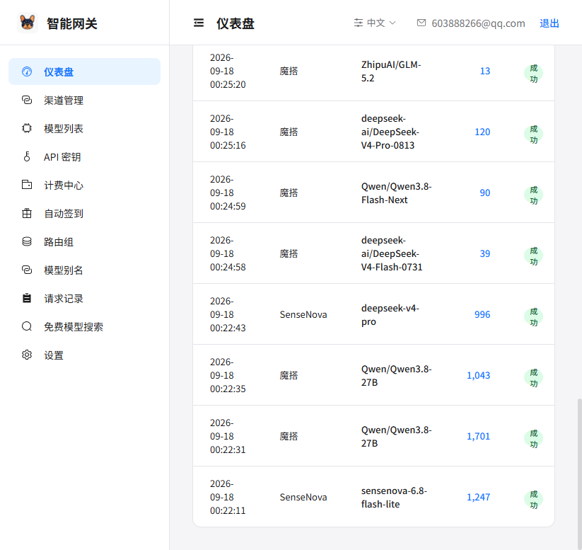
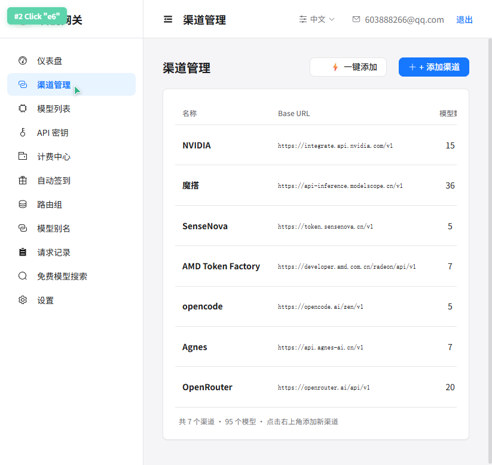
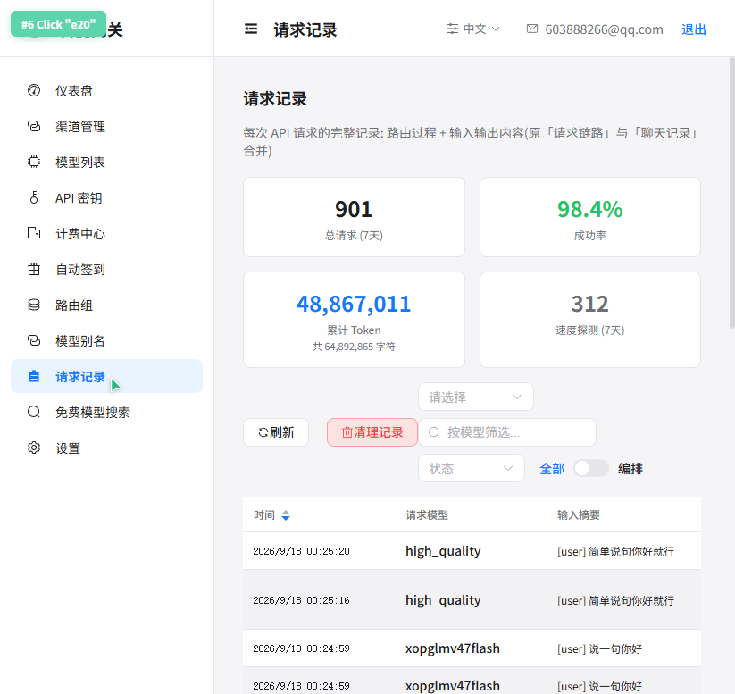
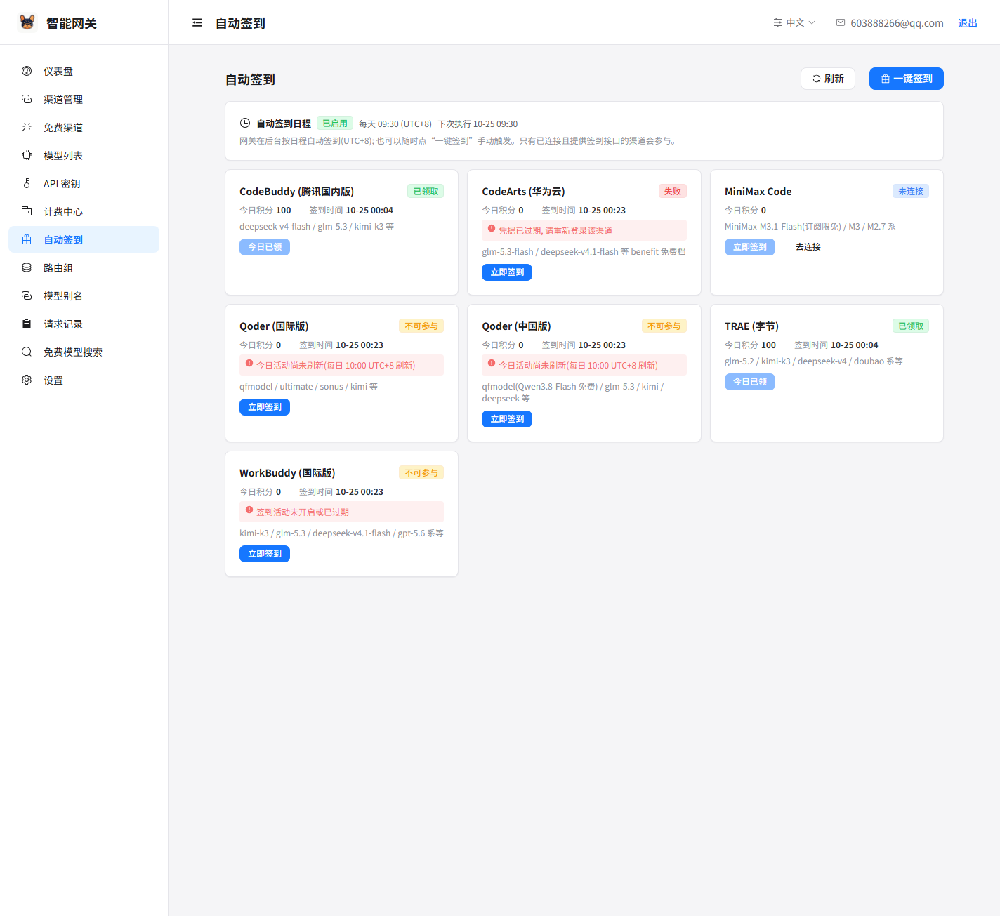

# 智能网关 · AI Gateway Pro

[](https://github.com/liruiqing76/ai-gateway-pro/actions/workflows/ci.yml)
[](LICENSE)
[](https://www.python.org/)
[](https://vuejs.org/)
[]()

> 一个 OpenAI 兼容端点，聚合所有模型的免费额度。
> One OpenAI-compatible endpoint, aggregating free quotas from every model provider.

> - README 中文：本文档
> - README English: [README.en.md](README.en.md)
> - 详细文档手册: [docs/](docs/00-概览.md)
- 已知问题与规划: [KNOWN_ISSUES.md](KNOWN_ISSUES.md)

`AI Gateway Pro` 把 NVIDIA、魔搭 ModelScope、SenseNova、AMD Token Factory、OpenRouter、OpenCode Zen、Agnes 等上游平台的**免费额度**统一收编，对外暴露**一个** OpenAI 兼容接口（`/v1`）。客户端只需填一个简单的模型名，剩下的一切——模型选择、路由决策、熔断降级、故障转移、额度控制——全部交给网关。

---

## 目录

- [核心特性](#-核心特性)
- [架构总览](#-架构总览)
- [一次请求如何工作](#-一次请求如何工作)
- [API 端点一览](#-api-端点一览)
- [界面截图](#-界面截图)
- [快速开始](#-快速开始)
- [接入示例](#-接入示例)
- [配置](#-配置)
- [测试](#-测试)
- [项目结构](#-项目结构)
- [文档索引](#-文档索引)
- [打包桌面版 exe](#-打包桌面版-exe)
- [授权说明](#-授权说明)
- [许可证](#-许可证)

---

## 🚀 核心特性

| 能力 | 说明 |
|------|------|
| **多渠道聚合** | 收敛 NVIDIA / 魔搭 / SenseNova / AMD / OpenRouter 等免费上游，密钥 **AES-256-GCM 加密存储**，预设模板一键添加、模型自动拉取 |
| **白嫖渠道适配** | 前端「免费渠道」页一键登录 **CodeArts / WorkBuddy / CodeBuddy / Cline / TRAE / Qoder(中国版+国际版) / MiniMax Code / LobsterAI(有道)** 等工具账号，其免费模型作为正式渠道出现（`trae-glm-5.2`、`qodercn-qfmodel`、`minimax-MiniMax-M3.1-Flash`、`lobsterai-glm-5.2`…），任意 OpenAI/Anthropic 客户端按名调用；TRAE SOLO 协议、Qoder wasm 加密端点、MiniMax Anthropic Messages 协议均由网关协议变换层接管；**每日签到**（CodeArts 积分 / TRAE 积分 / Qoder Credits / WorkBuddy·CodeBuddy billing / MiniMax 积分面板 / LobsterAI 活动积分）支持一键与每日自动两种模式 |
| **插件账号一键导入** | 已装 dsh-our-free-model 插件的机器可直接「导入插件账号」，从 `~/.dsh/.credentials.yaml` 读取已登录凭据建渠道，免二次浏览器授权 |
| **OpenCode 免费车道 v2** | 上游 2026-10 起改 v2 指纹门（`/inference/v1` + 官方 UA + 会话四头 + `read`/`shell` 逐字工具定义 + 降序 session 编码），网关已按主仓合同复刻；Kilo 免认证免费池自动收编 |
| **Anthropic 协议原生** | `POST /v1/messages` 原生 Anthropic Messages 端点（流式事件 / tool_use / thinking / count_tokens），Claude Code、Cline、Anthropic SDK 等客户端零改造直连 |
| **Responses 协议原生** | `POST /v1/responses` 原生 OpenAI Responses 端点（`instructions` / `input` 三种项 / 扁平 `tools` / `function_call` / `max_output_tokens` / 截断 `incomplete`），Codex CLI 与只讲 Responses 的 IDE 插件零改造直连；**三协议面共用同一套渠道、路由组、熔断与故障转移** |
| **免费源自动同步** | 定时拉取全网免费源 JSON 与本地模板合并，新增免费服务商自动进入「添加渠道」模板池 |
| **OpenCode Zen 自动渠道** | 定时发现 Zen 免费模型，真实探测 + 持续健康保活，失效模型自动移出 |
| **b.ai 自动渠道** | 定时拉取 b.ai 模型目录并健康探测（可选，可关，保留现有渠道不误清） |
| **智能路由组** | `quick` / `high_quality` / `vision` 三分类 + 用户自定义组，客户端填**组名/中文组名**即命中；每个白嫖渠道自动拥有同名组（`workbuddy` / `trae` / `qodercn` …），组内条目随渠道模型清单**自动对齐**（上游新增/下线模型无需重新登录，也保留你手动加进组里的其它模型） |
| **多种路由策略** | `quality` 质量优先 / `fastest` 最快优先 / `stable` 最稳优先 |
| **加权流量分发** | 轮询 + 「质量 × 今日用量平滑 × 渠道冷却」加权随机抽样，免费额度日日均摊，避免逮住单一模型打爆配额 |
| **熔断 + 故障转移** | 连续失败自动熔断、半开探测恢复；单次失败自动切换同组下一个候选，流式请求**无缝切换** |
| **限流冷却** | 命中 429 后指数退避（30s → 60s → 120s → 300s）；配额类 429 还会读取上游 `retry-after`，把"额度何时恢复"算成时刻 + 剩余时长写进错误文案（例：*该渠道免费额度已用尽, 上游将在 08:00(约 7 小时 25 分后) 恢复*），页面的免密车道卡片同步显示「额度 10-25 08:00 恢复」徽标，过点即自动消失；一旦判定为**渠道级**冷却，本次请求不再挨个试同渠道其余模型（免费池 9 个模型不再白打 9 次上游） |
| **多模型编排** | `relay:组A/组B` 接力（≤5 级）、`review:主/审` 审阅，最终一级支持流式输出 |
| **流式输出** | 单一请求与编排请求均支持 OpenAI SSE 流式 |
| **模型别名** | 自定义映射（`gpt-4` → 路由组），兼容现有 OpenAI 客户端 |
| **自动识图** | 请求内视觉识别自动选渠道，失败降级文本兜底 |
| **请求链路追踪** | 每次请求完整记录选路原因、实际渠道/模型、延迟、熔断/限流命中、编排阶段 |
| **用量统计 + 计费** | 请求数 / Token / 成功率统计；free / pro / enterprise 套餐与订单管理 |
| **自动签到** | 八家白嫖渠道每日定时签到（CodeArts / TRAE / Qoder 中国版+国际版 / WorkBuddy / CodeBuddy / MiniMax / LobsterAI），页面显示逐渠道真实结果、积分与失败原因，可一键/单渠道手动补签 |
| **免费模型情报** | 每日定时爬取 Gitee / GitHub / 百度 / 头条 / 公众号免费模型帖子，入库 + 可行性评估 + 生成报告 |
| **死模型自动复检** | 每日对拉黑模型做真实探测，误杀的 200 自动平反 |
| **多用户 + 双鉴权** | 每用户独立渠道 / 路由 / 别名 / 额度；**JWT + API Key** 双鉴权 |
| **桌面客户端** | pywebview + WebView2 壳，内嵌后端一键启动，支持开机自启 |

---

## 🏗️ 架构总览

```
┌─────────────────────────────────────────────────────┐
│             客户端 (OpenAI SDK / curl / 桌面UI)        │
└───────────────────────┬─────────────────────────────┘
                        │ HTTP
┌───────────────────────▼─────────────────────────────┐
│                 FastAPI 后端 (uvicorn)               │
│                                                     │
│   ┌────────────┐  ┌─────────────┐  ┌─────────────┐  │
│   │ auth 鉴权层 │  │ proxy 代理层 │  │ manage API  │  │
│   │ JWT/APIKey │  │   /v1/*     │  │   /api/*    │  │
│   └─────┬──────┘  └─────┬───────┘  └──────┬──────┘  │
│         │               │                  │         │
│   ┌─────▼───────────────▼──────────────────▼──────┐  │
│   │             core 核心引擎                      │  │
│   │  router_group → pick_available_models        │  │
│   │  → circuit(熔断) + scheduler(质量分)          │  │
│   │  → orchestrate(编排) + trace(链路)            │  │
│   └─────┬─────────────────────────┬──────────────┘  │
│         │  decrypt_secret         │                 │
│   ┌─────▼─────────────────────────▼──────────────┐  │
│   │             httpx AsyncClient (连接池)        │  │
│   └─────┬─────────────────────────┬──────────────┘  │
│         │                         │                 │
│   ┌─────▼─────────┐         ┌─────▼──────────┐      │
│   │ SQLite / MySQL │         │  上游 AI 平台    │      │
│   │ users/渠道/路由 │         │ NVIDIA/魔搭/... │      │
│   │ 链路/用量/订单  │         │                │      │
│   └───────────────┘         └────────────────┘      │
└─────────────────────────────────────────────────────┘
```

### 分层说明

- **auth 鉴权层**：API Key / JWT 双通道；bcrypt 密码哈希、AES-256-GCM 渠道密钥加密。
- **proxy 代理层**：`/v1/chat/completions`、`/v1/models` 等 OpenAI 兼容端点。
- **manage API**：渠道、路由组、别名、用量、追踪等管理端点（`/api/*`）。
- **core 核心引擎**：模型候选选择、熔断状态机、质量评分调度、编排执行、链路追踪上下文。
- **存储**：默认 SQLite（本地文件），可选 MySQL 8.0。

---

## ⚙️ 一次请求如何工作

以 `POST /v1/chat/completions`、`model: "high_quality"`、非流式为例：

```
1. 鉴权       get_current_user_from_api_key 校验 API Key
2. 配额       check_quota 校验今日调用次数
3. 装载上下文   查询 enabled=true 的渠道 / 路由组 / 别名 / 路由策略 → 关闭 session
4. 解密密钥    decrypt_secret 解密每个渠道的 API Key
5. 解析模型    parse_pipeline → 无编排；别名表无命中；normalize_group_name("high_quality")
6. 选候选      pick_available_models:
                - 组内模型集合 { NVIDIA-xxx, 魔搭-yyy, ... }
                - 排除熔断中的 → 按 strategy(quality)：质量分降序、延迟升序
7. 兜底候选    全渠道模型列表（放宽匹配）
8. 逐个尝试    候选1: forward_non_stream → 上游4xx → record_fail + 质量分降 → 候选2
              候选2: forward_non_stream → 200 → record_success + 质量分升
9. 记录        UsageLog + quota_used_today+1 + trace 落库
10. 返回       JSONResponse（model 字段标记为 "NVIDIA · deepseek-v3"）
```

**流式**：连接后预读首个 SSE chunk 校验有效性，无效视为失败切换候选；成功 → 直接 `StreamingResponse`，`X-Provider` / `X-Model` 头标记实际渠道 / 模型。

**编排**：命中 `relay:` / `review:` 时每个阶段内部重复步骤 6-8（阶段级故障转移）；非流式全部阶段执行完返回，流式最后一级才流式输出（前序需要完整输出作为下一级输入）。

---

## 🔌 API 端点一览

| 前缀 | 模块 | 用途 |
|------|------|------|
| `POST /v1/chat/completions` | proxy | OpenAI 兼容对话（流式/非流式、编排、别名） |
| `GET  /v1/models` | proxy | 可用模型列表 |
| `POST /v1/messages` | anthropic | **Anthropic Messages 原生端点**（流式/非流式、tool_use、thinking），Claude Code / Anthropic SDK / Cline 直连 |
| `POST /v1/messages/count_tokens` | anthropic | Anthropic token 计数（本地估算，不打上游） |
| `POST /v1/responses` | responses | **OpenAI Responses 原生端点**（流式/非流式、`function_call`、`instructions`、`max_output_tokens`），Codex CLI 与只讲 Responses 的 IDE 插件直连 |
| `POST /v1/responses/input_tokens` | responses | Responses 输入 token 估算（本地估算，不打上游） |
| `/api/providers` | providers | 渠道 CRUD + 预设模板 |
| `/api/channels` | channels | 白嫖渠道目录 / 登录 / 签到 / 免密车道同步 |
| `GET  /api/channels/import/scan` | channels | 扫描本机插件凭据库，预览可导入的渠道账号 |
| `POST /api/channels/import/apply` | channels | 一键导入插件账号并建渠道 + 独立路由组 |
| `POST /api/channels/checkin` | channels | 一键签到（全渠道 / 单渠道 `checkin/{channel}`） |
| `GET  /api/channels/checkin/status` | channels | 今日逐渠道签到结果 + 积分 + 失败原因 + 自动签到日程 |
| `/api/routers` | routers | 路由组 CRUD |
| `/api/routers/check-availability` | router_check | 路由组可用性检测 |
| `/api/aliases` | aliases | 模型别名 CRUD |
| `/api/traces` | traces | 请求链路查询 / 统计 / 清理 |
| `/api/usage` | usage | 用量统计 |
| `/api/free-sources` | free_sources | 免费源自动同步 |
| `/api/free-model-search` | free_model_search | 免费模型帖子搜索报告 |
| `/api/dead-models` | dead_model_api / downed_models | 失活模型管理 & 自动复检 |
| `/api/chats` | chats | 会话记录 |
| `/api/requests` | requests | 请求/计费记录 |
| `/api/experience` | experience | 经验积累（LLM 提炼，默认关） |
| `/api/license` | license | 设备绑定 / 授权状态 |
| `（auth）` | auth | 注册 / 登录 / 刷新 / API Key 轮换 |

> 完整字段与请求/响应示例见 [docs/03-API参考.md](docs/03-API参考.md)。

---

## 🖥️ 界面截图

| 界面 | 预览 |
|------|------|
| 仪表盘 Dashboard |  |
| 渠道管理 Providers |  |
| 路由组 Routers |  |
| 请求日志 Traces |  |
| 自动签到 Auto Checkin |  |

*以上为实际运行界面截图。*

---

## 🚀 快速开始

### 环境要求

- Python 3.10+（推荐 3.11+）
- Node.js 18+（仅构建前端时需要）
- Windows / macOS / Linux

### 安装与启动

```bash
# 1. 创建虚拟环境并安装后端依赖
python -m venv .venv
# Windows
.venv\Scripts\activate
# macOS / Linux
source .venv/bin/activate
pip install -r requirements.txt

# 2. 构建前端（输出到 web/，由后端静态托管）
cd web-vue
npm install
npm run build
cd ..

# 3. 启动 —— 桌面客户端（推荐）
python desktop/desktop.py

# 或纯 Web（仅后端）模式
python -m uvicorn backend.main:app --host 127.0.0.1 --port 8765
```

浏览器打开 `http://127.0.0.1:8765`，按下面三步即可开始使用：

1. **注册 / 登录**
2. **添加渠道** —— 「渠道管理 → 模板一键添加」（NVIDIA、魔搭、SenseNova、AMD、OpenRouter 等），填入平台 API Key
3. **复制 API Key** —— 「API 密钥」生成后，用任意 OpenAI 客户端指向网关 `http://127.0.0.1:8765/v1`

---

## 💻 接入示例

### OpenAI Python SDK

```python
from openai import OpenAI

client = OpenAI(
    base_url="http://127.0.0.1:8765/v1",
    api_key="你的API密钥",          # 网关分配的 API Key
)

resp = client.chat.completions.create(
    model="high_quality",          # 路由组名 / 别名 / 编排格式 / 具体模型名
    messages=[{"role": "user", "content": "你好"}],
)
print(resp.choices[0].message.content)
```

### curl（非流式）

```bash
curl http://127.0.0.1:8765/v1/chat/completions \
  -H "Authorization: Bearer 你的API密钥" \
  -H "Content-Type: application/json" \
  -d '{"model":"quick","messages":[{"role":"user","content":"你好"}]}'
```

### curl（流式 SSE）

```bash
curl http://127.0.0.1:8765/v1/chat/completions \
  -H "Authorization: Bearer 你的API密钥" \
  -H "Content-Type: application/json" \
  -d '{"model":"quick","stream":true,"messages":[{"role":"user","content":"你好"}]}'
```

### 进阶：多模型编排与别名

- 接力编排：`model = "relay:组A/组B"`（A 的输出接给 B，最多 5 级）
- 审阅编排：`model = "review:主/审"`（主答 + 审阅修正，最终流式输出）
- 模型别名：`gpt-4` → 某个路由组，让现有 OpenAI 客户端无缝接入

> 详细用法见 [docs/02-功能指南.md](docs/02-功能指南.md)。

### Anthropic 客户端直连（Claude Code / Cline / Anthropic SDK）

网关原生说 Anthropic Messages 协议（`/v1/messages`，含流式事件、tool_use、thinking），无需任何转换垫片。鉴权同时接受 `Authorization: Bearer` 与 `x-api-key`。

**Claude Code**（环境变量方式）：

```bash
export ANTHROPIC_BASE_URL=http://127.0.0.1:8765
export ANTHROPIC_AUTH_TOKEN=你的API密钥      # 网关分配的 API Key
export ANTHROPIC_MODEL=high_quality          # 路由组名 / 别名 / 具体模型名
# Windows PowerShell:
# $env:ANTHROPIC_BASE_URL="http://127.0.0.1:8765"
# $env:ANTHROPIC_AUTH_TOKEN="你的API密钥"
# $env:ANTHROPIC_MODEL="high_quality"
```

**Anthropic Python SDK**：

```python
from anthropic import Anthropic

client = Anthropic(
    base_url="http://127.0.0.1:8765",
    api_key="你的API密钥",                    # 网关分配的 API Key
)
resp = client.messages.create(
    model="high_quality",                     # 路由组名 / 别名 / 具体模型名
    max_tokens=1024,
    messages=[{"role": "user", "content": "你好"}],
)
print(resp.content[0].text)
```

**curl（Anthropic 形状）**：

```bash
curl http://127.0.0.1:8765/v1/messages \
  -H "x-api-key: 你的API密钥" \
  -H "anthropic-version: 2023-06-01" \
  -H "content-type: application/json" \
  -d '{"model":"high_quality","max_tokens":1024,"messages":[{"role":"user","content":"你好"}]}'
```

> `/v1/messages` 与 `/v1/chat/completions` 共用同一套路由组、别名、熔断与故障转移；编排（`relay:` / `review:`）与自动识图目前仅在 `/v1/chat/completions` 提供。

### Codex CLI / Responses 客户端直连

网关原生说 OpenAI Responses 协议（`/v1/responses`，含流式事件、`function_call`、`instructions`），Codex CLI 只需在 `~/.codex/config.toml` 里把线协议指成 `responses`：

```toml
model = "trae-glm-5.2"           # 渠道-模型名 / 路由组名 / 别名
model_provider = "aigw"

[model_providers.aigw]
name = "AI Gateway"
base_url = "http://127.0.0.1:8765/v1"
env_key = "AIGW_API_KEY"         # 指向你的网关 API Key
wire_api = "responses"
```

```bash
curl http://127.0.0.1:8765/v1/responses \
  -H "Authorization: Bearer 你的API密钥" \
  -H "content-type: application/json" \
  -d '{"model":"high_quality","instructions":"Be terse.","input":"你好","max_output_tokens":1024}'
```

> `/v1/responses` 与另外两个面共用同一套渠道、路由组、别名、熔断与故障转移；请求体按 Responses 语义转换（`instructions`→system、`input` 里的 `function_call`/`function_call_output`→assistant `tool_calls`/`role:tool`、扁平 `tools`→chat `function`），响应侧产出 `response.created` / `output_item.added` / `output_text.delta` / `function_call_arguments.delta` / `output_item.done` / `response.completed` 事件，被 `max_output_tokens` 截断时按协议给 `status="incomplete"` + `incomplete_details.reason="max_output_tokens"`。

### OpenCode CLI 直连

`opencode` 只吃 OpenAI 兼容 provider，用一份独立配置即可接网关（**不要**动用户全局配置）：

```json
{
  "$schema": "https://opencode.ai/config.json",
  "provider": {
    "aigw": {
      "npm": "@ai-sdk/openai-compatible",
      "name": "AI Gateway",
      "options": {
        "baseURL": "http://127.0.0.1:8765/v1",
        "apiKey": "你的API密钥"
      },
      "models": { "trae-glm-5.2": {}, "workbuddy-deepseek-v4.1-flash": {} }
    }
  }
}
```

```bash
# OPENCODE_CONFIG 指向上面这份文件, 然后按 渠道-模型名 调用
opencode run --model aigw/trae-glm-5.2 "只回复两个字: 收到"
```

> 已真机验证：Claude Code 2.1.212 与 OpenCode 1.18.18 均能经网关跑通**文本、流式、工具调用、多轮工具循环**（读文件回显内容）。Claude Code 若全局 `~/.claude/settings.json` 里已有 `env.ANTHROPIC_BASE_URL`，其优先级高于进程环境变量，需用 `CLAUDE_CONFIG_DIR` 指向独立配置目录。

---

## ⚙️ 配置

所有配置项前缀 `GW_`，可用环境变量或修改 `backend/config.py`（pydantic-settings，同时读取 `.env`）。常用项：

| 变量 | 默认值 | 说明 |
|------|--------|------|
| `GW_HOST` | `127.0.0.1` | 监听地址 |
| `GW_PORT` | `8000` | 监听端口 |
| `GW_DATABASE_URL` | 空（自动 SQLite） | 数据库连接串（支持 MySQL） |
| `GW_SECRET_KEY` | `CHANGE_ME...` | JWT / 加密密钥（生产必须修改） |
| `GW_DEBUG` | `false` | 调试模式 |
| `GW_PROXY_TIMEOUT_SECONDS` | `120` | 上游请求总超时 |
| `GW_PROXY_STREAM_READ_TIMEOUT` | `30` | 流式读超时（卡住自动换候选） |
| `GW_PROXY_NONSTREAM_READ_TIMEOUT` | `30` | 非流式读超时 |
| `GW_ROUND_ROBIN_ENABLED` | `true` | 轮询分发 |
| `GW_SPREAD_WEIGHTED_ENABLED` | `true` | 加权流量分发 |
| `GW_SHAPING_DEFAULT_MAX_CONCURRENCY` | `4` | 渠道并发上限 |
| `GW_CHECKIN_ENABLED` | `true` | 自动签到开关 |
| `GW_FREE_SOURCE_AUTO_SYNC` | `true` | 免费源自动同步 |
| `GW_ZEN_AUTO_SYNC` | `true` | OpenCode Zen 自动渠道 |
| `GW_ZEN_SYNC_HOURS` | `6` | opencode 免费池同步间隔（只探测新增模型，不重复烧额度） |
| `GW_ZEN_HEALTH_CHECK_MINUTES` | `0` | opencode 定时体检；**0=关闭**（体检=每模型发一次真实请求，会提前烧光公共免费额度；死模型改由真实流量判定）。需要时设正数分钟 |
| `GW_KILO_AUTO_SYNC` | `true` | Kilo 免认证免费池自动同步 |
| `GW_SPEED_CHECK_SKIP_GROUPS` | `opencode,kilo` | 后台测速跳过的路由组（公共额度车道；测速经 failover 会试完整组模型） |
| `GW_STATE_DIR` | 空（跟随数据库目录） | 签到 / 车道状态文件落盘目录 |
| `GW_CHANNEL_CHECKIN_ENABLED` | `true` | 白嫖渠道每日自动签到（CodeArts/TRAE/Qoder/WorkBuddy/CodeBuddy/MiniMax/LobsterAI） |
| `GW_CHANNEL_CHECKIN_TIME` | `09:30` | 每日签到时刻（UTC+8） |
| `GW_UPSTREAM_PROXY` | 空 | 上游出站代理：空=跟随系统；`none`=强制直连（系统代理半死导致上游 EOF 时用）；或显式 `http://127.0.0.1:7892` |
| `GW_DSH_CREDENTIALS` | 空 | 插件凭据库路径（默认 `~/.dsh/.credentials.yaml`），供「导入插件账号」用 |
| `GW_LICENSE_ENABLED` | `true` | 本地设备硬件绑定开关 |

> 完整配置项及说明见 [backend/config.py](backend/config.py)。

---

## 🧪 测试

```bash
pytest tests/ -v                  # 全部用例（124+，含性能基准）
pytest tests/test_performance.py  # 性能基准
```

---

## 📂 项目结构

```
ai-gateway-pro/
├── backend/                 # FastAPI 后端
│   ├── main.py              # 应用入口，路由注册，后台定时任务
│   ├── config.py            # 配置（GW_* 环境变量 / .env）
│   ├── api/                 # API 路由层（proxy/providers/routers/usage/traces…）
│   ├── core/                # 核心引擎（路由/熔断/编排/质量调度/免费源/Zen同步）
│   ├── auth/                # 鉴权（JWT / API Key / AES 加密 / 授权绑定）
│   ├── billing/             # 计费模块
│   ├── models/              # SQLAlchemy ORM 模型
│   └── data/                # SQLite 数据库与模板
├── web-vue/                 # Vue 3 前端源码
├── web/                     # 前端构建产物（后端静态托管）
├── desktop/                 # pywebview 桌面壳 + 自动签到
├── docs/                    # 中文文档手册（00~06）
├── tests/                   # 测试套件（124+ 用例）
└── smart-gateway-design/    # 高保真设计稿原型
```

---

## 📖 文档索引

| 文档 | 内容 |
|------|------|
| [00-概览](docs/00-概览.md) | 项目介绍、能力矩阵、技术栈、架构 |
| [01-快速开始](docs/01-快速开始.md) | 安装 / 运行 / 打包 / 配置 / FAQ |
| [02-功能指南](docs/02-功能指南.md) | 每个功能的详细用法 |
| [03-API参考](docs/03-API参考.md) | 全部 HTTP 端点与请求 / 响应示例 |
| [04-架构设计](docs/04-架构设计.md) | 模块职责、请求决策链路、数据表、设计决策 |
| [05-运维与性能](docs/05-运维与性能.md) | 日志、链路追踪、性能基准、FAQ |
| [06-渠道注册与接入](docs/06-渠道注册与接入文档.md) | 各上游渠道的注册与接入参数 |

---

## 📦 打包桌面版 exe

```bash
pip install pyinstaller
pyinstaller ai_gateway_pro.spec   # 输出 dist/智能网关.exe
```

---

## 📄 授权说明

本仓库同时包含**开源核心**与**商业授权增强模块**（如设备绑定 / 远程授权锁定）。

- 商业授权模块代码保留在仓库中，但可通过 `GW_LICENSE_ENABLED=false` 关闭验证，不影响正常功能使用。
- 开源使用 / 个人自用默认不受锁约束。

---

## 🔗 许可证

本仓库采用 [MIT License](LICENSE)（开源核心部分另附商用条款，见上「授权说明」）。

---

## 🙏 致谢

基于开源生态构建：

- FastAPI · SQLAlchemy 2 · httpx
- Vue 3 · Element Plus
- APScheduler · pywebview · PyInstaller